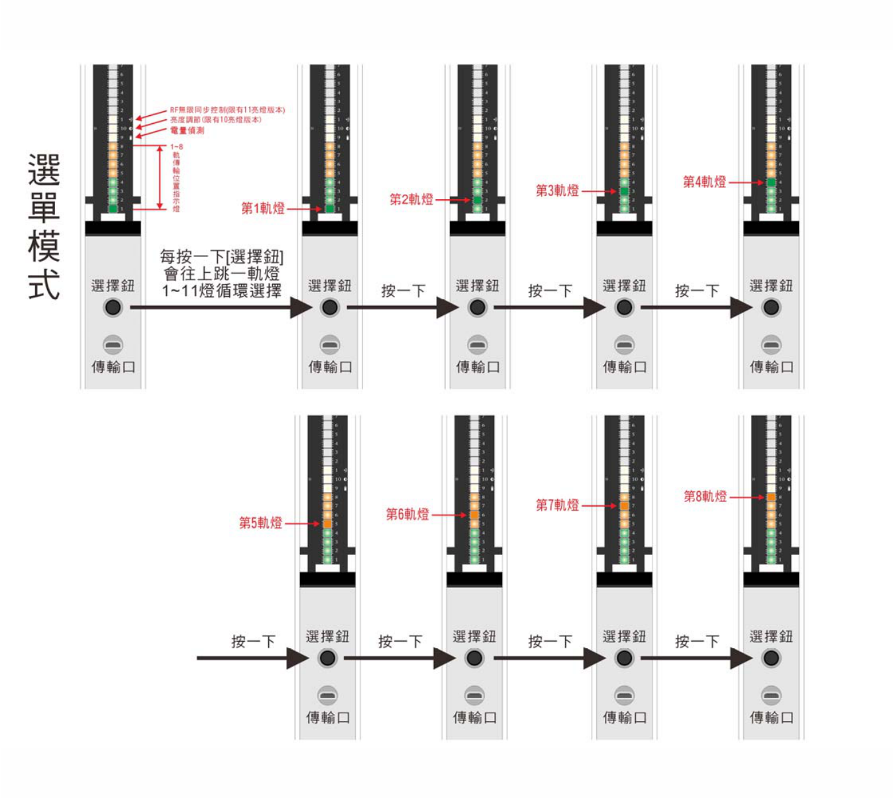
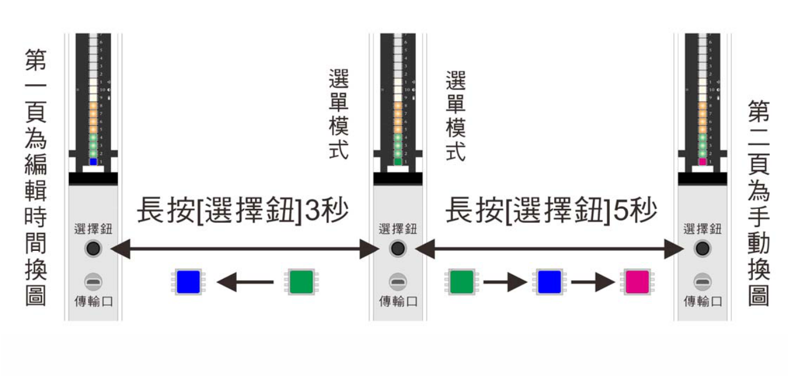
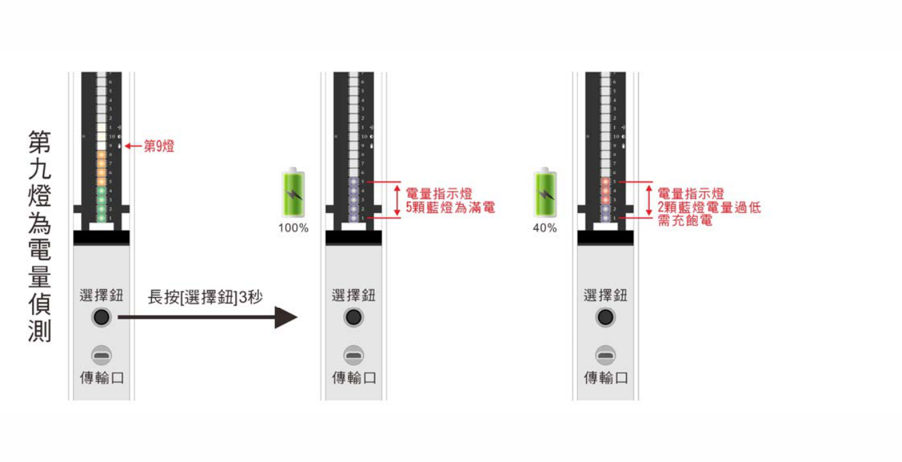
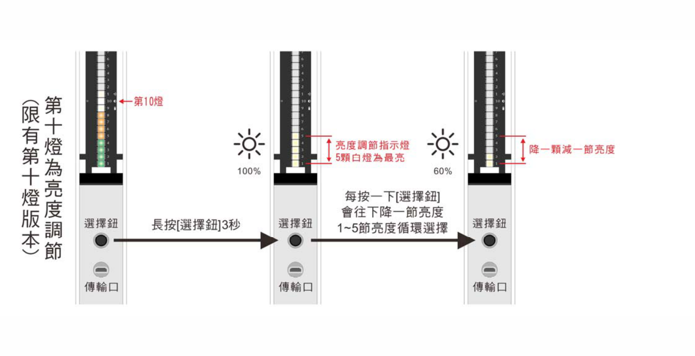

## Pixel MR 道具操作說明

道具上只有一顆 **選擇鈕**，下方為 USB **傳輸口**。燈條第 1–8 燈對應 8 個軌道，第 9 燈為電量偵測，第 10 燈為亮度調節（限有第十燈的版本）。開機後道具停在 **選單模式**，此時才能從軟體上傳圖樣。

### 選擇軌道（1–8 軌）

- 選單模式下，每按一下 **選擇鈕** 會往上跳一軌（1–11 燈循環），跳到想顯示的軌道。
- 長按 **選擇鈕** 啟動該軌，詳見下一節。
- 要回選單模式：長按 **選擇鈕** 3 秒後放開。

> 選擇的軌道沒有傳輸檔案，或按鈕按太快時，道具會閃紅燈。

### 每軌兩頁顯示模式

| 模式 | 進入方式 | 指示燈 | 換圖方式 |
|---|---|---|---|
| 第一頁：編輯時間換圖 | 長按 **選擇鈕** 3 秒 | 亮藍光 | 依軟體編輯的時間自動換圖 |
| 第二頁：手動換圖 | 長按 **選擇鈕** 5 秒 | 亮粉紅光 | 每按一下 **選擇鈕** 換下一張圖 |

1. 在選單模式下選好軌道。
2. 長按 **選擇鈕** 直到出現對應顏色後放開，道具進入準備狀態。
3. 再按一下 **選擇鈕**，道具開始顯示。

> 用 **選擇鈕** 啟動，圖樣時間最精準；用電源鈕開啟會有些許秒差。

- 顯示中要回選單模式：長按 **選擇鈕** 3 秒後放開。
- 當機時回選單模式：按住 **選擇鈕** 不放，同時關閉或開啟主電源，再放開 **選擇鈕**。

### 第九燈：電量偵測

按 **選擇鈕** 跳到第九燈，長按 **選擇鈕** 3 秒進入電量偵測，以藍燈數量顯示目前電量：

| 藍燈數 | 電量 |
|---|---|
| 5 | 100% |
| 4 | 80% |
| 3 | 60% |
| 2 | 40%，**必須充電** |

建議每次使用後就充電。

### 第十燈：亮度調節（限有第十燈版本）

1. 按 **選擇鈕** 跳到第十燈，長按 **選擇鈕** 3 秒進入亮度調節。
2. 每按一下 **選擇鈕** 降一節亮度（1–5 節循環），以藍燈數量顯示目前亮度：

   | 藍燈數 | 亮度 |
   |---|---|
   | 5 | 100% |
   | 4 | 90% |
   | 3 | 70% |
   | 2 | 60% |
   | 1 | 50% |

3. 選好亮度後長按 **選擇鈕** 3 秒，設定完成並回到選單模式。

要調回原本亮度，同樣回到第十燈依上述步驟調節。
