# PixelM Creator X 使用說明

PixelM Creator X 是 Pixel MR 系列 POV（視覺暫留）旋轉道具的燈光編輯軟體。你可以把圖騰效果、單色、文字或圖片排進時間軸，搭配音樂預覽，再透過 USB 上傳到道具。

- 專案檔格式：`.pmc4`（舊版 `.pmc` / `.pmc3` 請用舊版軟體開啟）
- 支援的圖片：jpg、jpeg、png、bmp、gif
- 支援的音樂：mp3、wav

---

## 目錄

1. [啟動畫面](#1-啟動畫面)
2. [主畫面總覽](#2-主畫面總覽)
3. [上方工具列與道具設定](#3-上方工具列與道具設定)
4. [編輯面板：建立圖樣](#4-編輯面板建立圖樣)
   - [圖騰](#41-圖騰)
   - [單色](#42-單色)
   - [文字](#43-文字)
   - [使用圖片](#44-使用圖片)
   - [顏色選擇與色票](#45-顏色選擇與色票)
   - [時間、重複次數與插入](#46-時間重複次數與插入)
5. [預覽區與播放控制](#5-預覽區與播放控制)
6. [時間軸](#6-時間軸)
7. [上傳到道具](#7-上傳到道具)
8. [檔案選單與其他功能](#8-檔案選單與其他功能)
9. [快捷鍵](#9-快捷鍵)
10. [常見問題](#10-常見問題)
11. [Pixel MR 道具操作說明](#pixel-mr-道具操作說明)

---

## 1. 啟動畫面

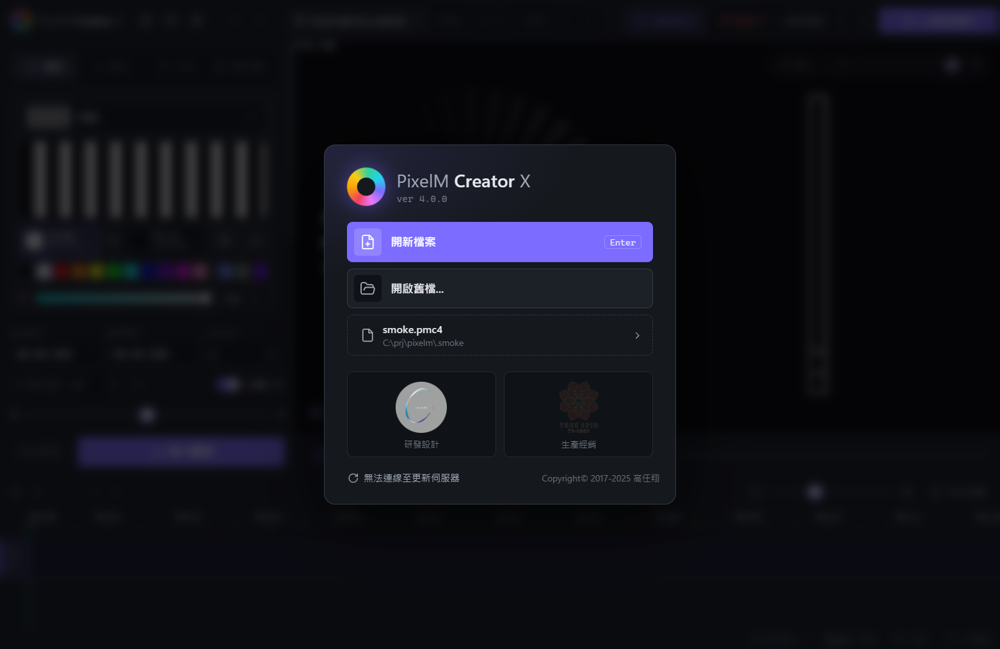

開啟軟體後會先看到啟動畫面：

| 項目 | 說明 |
|---|---|
| **開新檔案** | 建立空白專案（直接按 `Enter` 也可以） |
| **開啟舊檔...** | 選擇一個 `.pmc4` 專案檔開啟 |
| **最近的專案** | 顯示上次開啟的專案，點一下即可直接開啟 |
| **位元創意 / 生產經銷** | 開啟廠商網站 |
| **檢查更新...** | 啟動時會自動檢查新版本；有更新時會詢問是否下載安裝 |

---

## 2. 主畫面總覽

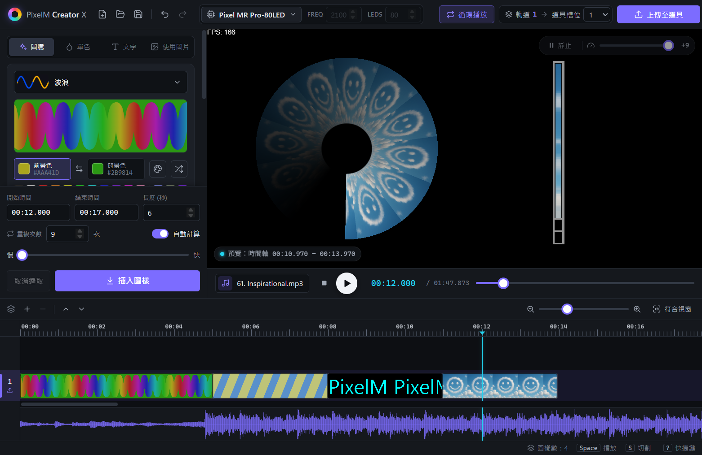

主畫面分為四個區域：

1. **上方工具列**：檔案操作、復原 / 重作、道具型號、上傳。
2. **左側編輯面板**：選擇圖樣類型（圖騰 / 單色 / 文字 / 使用圖片）並調整參數、時間，然後插入到時間軸。
3. **中間預覽區**：模擬道具旋轉時的視覺效果；下方是音樂與播放控制。
4. **下方時間軸**：排列所有圖樣的軌道，可拖曳、調整長度、複製貼上。

最下方的狀態列會顯示目前的圖樣數量，以及常用快捷鍵提示（按 `?` 可開啟完整快捷鍵表）。

---

## 3. 上方工具列與道具設定

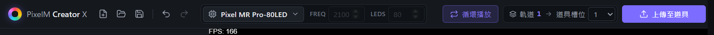

由左到右：

| 項目 | 說明 |
|---|---|
| 開新檔案 / 讀檔 / 存檔 | 對應 `Ctrl+N` / `Ctrl+O` / `Ctrl+S` |
| 復原 / 重作 | 對應 `Ctrl+Z` / `Ctrl+Y` |
| **道具型號** | 選擇你的 Pixel MR 型號，會自動帶入 Freq（頻率）與 LEDs（燈珠數） |
| **循環播放** | 開啟後，道具播放完會自動從頭重複 |
| **軌道 → 道具槽位** | 顯示要上傳的軌道，以及要寫入道具的哪一個槽位（1–8） |
| **上傳至道具** | 把目前軌道轉檔並上傳（`Ctrl+U`） |

### 選擇道具型號

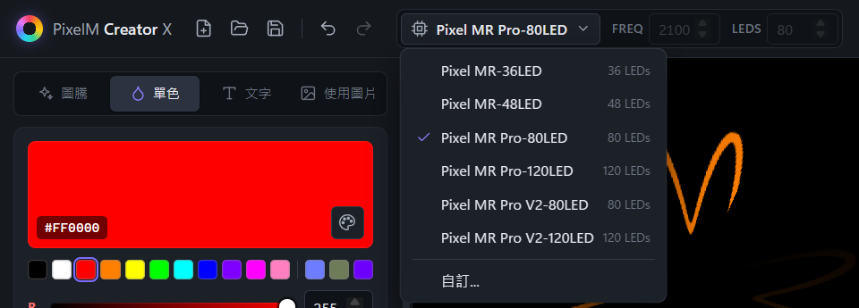

點型號名稱會列出所有支援的道具及燈珠數。請選擇與手上道具相同的型號，預覽與上傳的資料才會正確。
如果是清單中沒有的道具，選 **自訂...**，再手動輸入 Freq 與 LEDs。

> 換型號會改變燈珠數，圖樣的高度與預覽也會跟著重新計算。建議在開始編輯前先選好型號。

---

## 4. 編輯面板：建立圖樣

編輯面板最上方有四個分頁，分別是四種圖樣類型。調整好之後按下方的 **插入圖樣**，就會把圖樣放到時間軸上。

### 4.1 圖騰

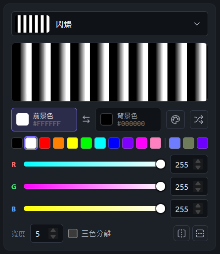

圖騰是內建的動態花樣。點最上方的效果名稱會開啟效果選單：

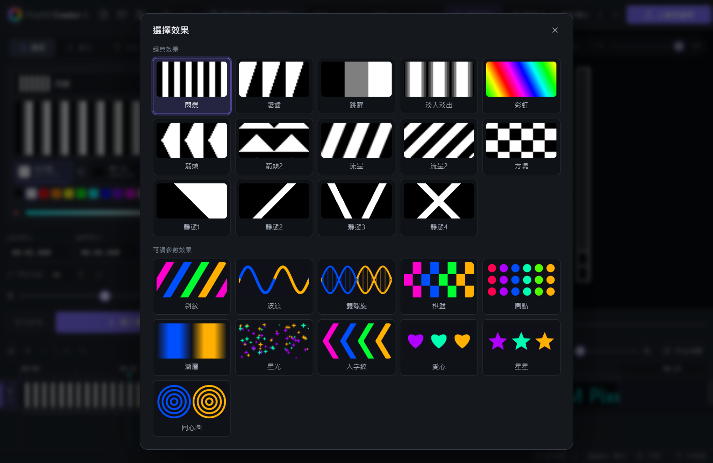

- **經典效果**：閃爍、鋸齒、跳躍、淡入淡出、彩虹、箭頭、流星、方塊、靜態 1–4 等。
- **可調參數效果**：斜紋、波浪、雙螺旋、棋盤、圓點、漸層、星光、人字紋、愛心、星星、同心圓。這類效果可以調整更多細節。

選擇可調參數效果後，下方會多出對應的參數滑桿，例如「波浪」可以調整週期、粗細、振幅、柔和度：

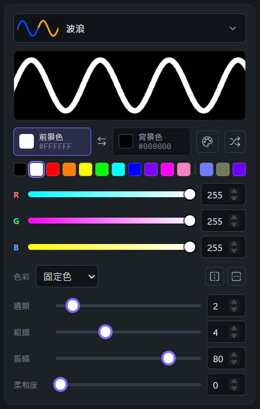

| 設定 | 說明 |
|---|---|
| 前景色 / 背景色 | 點選要編輯的顏色，再用色票或 RGB 調整；中間的 ⇆ 可以互換兩色 |
| 隨機（🔀） | 隨機產生一組顏色 |
| 色彩 | 可調參數效果專用：**固定色**、**逐個變色**（每次重複換一個色相）、**彩虹漸層** |
| 寬度 | 經典效果的圖樣寬度 |
| 三色分離 | 把顏色拆成 R / G / B 三色呈現（可切換三種狀態） |
| ⇆ H / ⇅ V | 水平 / 垂直翻轉 |

### 4.2 單色

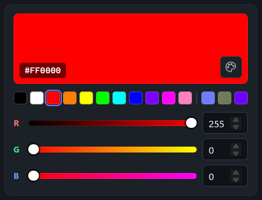

整支道具亮同一個顏色。可以點色票、拖曳 RGB 滑桿、直接輸入數值，或點右下角的調色盤按鈕開啟系統的顏色選擇器。

### 4.3 文字

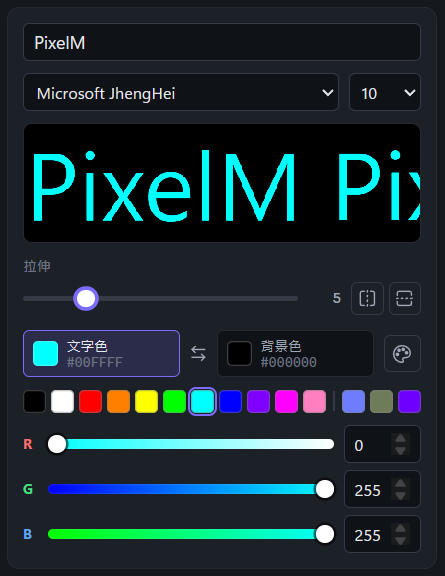

| 設定 | 說明 |
|---|---|
| 文字輸入框 | 輸入要顯示的文字 |
| 字型 / 大小 | 使用電腦已安裝的字型，大小 1–10 |
| 拉伸 | 把文字水平拉長（1–20），旋轉速度快時可以讓字比較不會擠在一起 |
| ⇆ H / ⇅ V | 水平 / 垂直翻轉 |
| 文字色 / 背景色 | 點選要編輯的顏色後調整，⇆ 互換 |

預覽框會顯示文字實際在道具上的樣子（會重複填滿）。

### 4.4 使用圖片

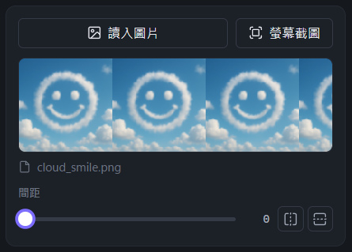

| 設定 | 說明 |
|---|---|
| **讀入圖片** | 從電腦選擇圖片（可一次選多張） |
| **螢幕截圖** | 擷取螢幕畫面，可以裁切、用畫筆或橡皮擦修改後存成圖片並載入 |
| 間距 | 每次重複之間的空白距離 |
| ⇆ H / ⇅ V | 水平 / 垂直翻轉 |

圖片會依道具燈珠數自動縮放成適合的高度。

> 專案只會記錄圖片的路徑。如果移動或刪除了原始圖片，下次開啟專案時會提示「圖片遺失」，可以選擇搜尋並取代。

> macOS 第一次使用螢幕截圖時，需要到「系統設定 › 隱私權與安全性 › 螢幕錄製」允許本程式。

### 4.5 顏色選擇與色票

在 圖騰、單色、文字 分頁的顏色區塊下方都有一排色票：

- **前面 11 格**：常用顏色（黑、白、紅、橙、黃、綠、青、藍、紫、洋紅、粉紅），點一下就套用。
- **分隔線後的 3 格**：最近用過的顏色。不論是用滑桿、調色盤或色票選的顏色都會被記住（常用色本身不會重複加入）。尚未使用過時會顯示虛線空格。
- 目前的顏色如果剛好在色票裡，那一格會有外框標示。

### 4.6 時間、重複次數與插入

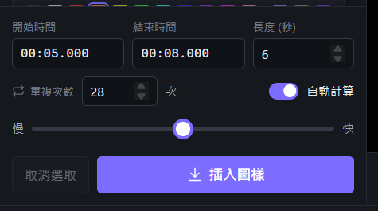

| 設定 | 說明 |
|---|---|
| 開始時間 / 結束時間 | 圖樣在時間軸上的起訖時間（格式 `分:秒.毫秒`） |
| 長度（秒） | 圖樣持續的秒數，修改後會自動更新結束時間 |
| 重複次數 | 圖樣在這段時間內重複幾次，次數越多看起來轉得越快 |
| 自動計算 | 開啟後依「慢 ↔ 快」滑桿自動算出重複次數；關閉則可手動輸入次數 |
| **插入圖樣** | 把目前的圖樣放到目前軌道的開始時間位置。插入後開始時間會自動移到這個圖樣的結尾，方便接著插入下一個 |
| 取消選取 | 取消時間軸上的選取 |

在時間軸上選取一個圖樣時，該圖樣的設定會載入編輯面板，按鈕會變成 **套用編輯**。修改後按下即可更新那個圖樣：

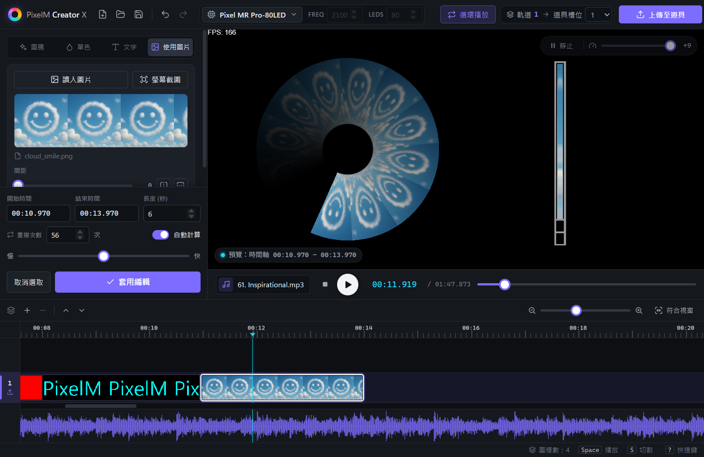

> 插入或移動圖樣時，如果與同軌道的其他圖樣重疊，新放的圖樣優先，被蓋到的圖樣會被裁短、切開或刪除。

---

## 5. 預覽區與播放控制

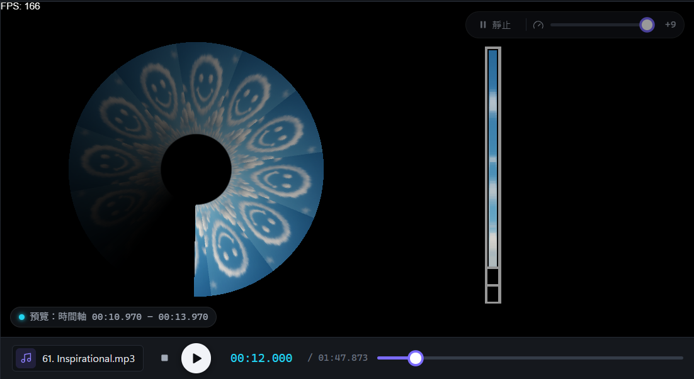

- **中間的圓形**：模擬道具旋轉時看到的畫面。
- **右側的長條**：道具上燈條目前顯示的內容。
- **左下角標籤**：顯示預覽來源：
  - `預覽：編輯中`：正在預覽編輯面板裡尚未插入的圖樣
  - `預覽：時間軸 00:00.000 – 00:06.000`：正在預覽時間軸上播放頭所在的圖樣
  - `預覽：無圖樣`：播放頭位置沒有圖樣
- **右上角**：「靜止」可以暫停旋轉；滑桿調整預覽的旋轉速度（只影響預覽，不影響上傳結果）。

預覽區下方是播放控制：

| 項目 | 說明 |
|---|---|
| **選歌**（♪ 未選擇音樂） | 載入 mp3 / wav 音樂，時間軸會顯示波形，方便對拍 |
| ■ 停止 | 停止並回到開頭 |
| ▶ 播放 / 暫停 | 也可以按 `Space` |
| 時間 / 總長度 | 目前播放頭位置 / 所有圖樣的總長度 |
| 進度條 | 拖曳可以移動播放頭 |

---

## 6. 時間軸

時間軸可以有多條軌道。左側的數字是軌道編號，帶有上傳圖示（⤒）的是 **目前軌道**：插入圖樣、貼上與上傳都會使用這條軌道。點一下軌道就能把它設為目前軌道。

### 基本操作

| 操作 | 方式 |
|---|---|
| 選取圖樣 | 點一下圖樣 |
| 移動圖樣 | 拖曳圖樣（可以拖到其他軌道） |
| 調整長度 | 拖曳圖樣的左右邊緣（會自動吸附到相鄰圖樣與播放頭） |
| 跳到圖樣頭尾 | 雙擊圖樣，播放頭會在圖樣開頭與結尾之間切換 |
| 微調位置 | 選取後按 `←` / `→`（10 毫秒），加 `Shift`（100 毫秒） |
| 在播放頭切割 | 按 `S` |
| 刪除 | 按 `Del` |
| 移動播放頭 | 點時間尺，或按 `←` / `→`（未選取圖樣時） |
| 縮放 | 右上角滑桿、放大鏡按鈕，或 `Ctrl + 滾輪`（以滑鼠位置為中心） |
| 符合視窗 | 把所有圖樣縮放到剛好顯示在畫面中 |

左上角的按鈕依序為：**增加軌道（＋）**、**刪除軌道（－）**、**上移軌道（︿）**、**下移軌道（﹀）**。

### 右鍵選單

在圖樣上按右鍵：**複製**、**剪下**、**移除**。

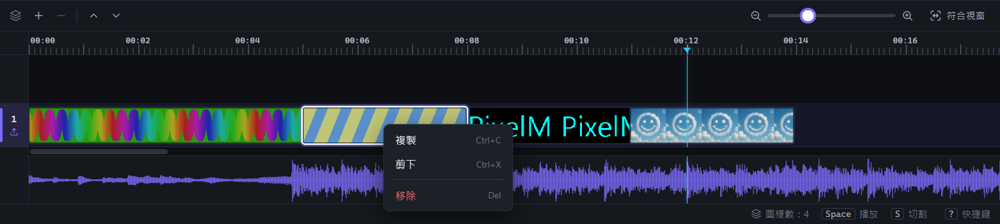

在軌道空白處按右鍵：**貼上**（貼到播放頭位置）、**複製軌道**、**移除軌道**：

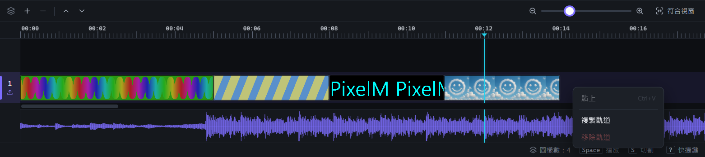

在時間尺上按右鍵可以 **設定起始** / **取消起始**：把播放頭位置設為上傳後道具的起始時間點（例如要略過音樂前奏時使用）。

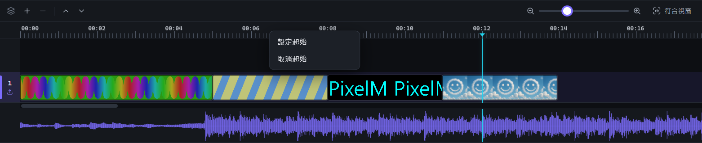

---

## 7. 上傳到道具

1. 用 USB 連接道具並開機。
2. 在時間軸點選要上傳的軌道（左側出現 ⤒ 圖示）。
3. 在上方工具列確認 **軌道 N → 道具槽位** 的槽位編號（1–8）。
4. 需要道具播完自動重來時，開啟 **循環播放**。
5. 按 **上傳至道具**（或 `Ctrl+U`）。按鈕會依序顯示「轉檔中...」、「傳輸中... xx%」，完成後會跳出「上傳完成」。

傳輸中再按一次按鈕可以取消上傳。

| 訊息 | 處理方式 |
|---|---|
| 偵測不到裝置！ | 確認 USB 線已連接、道具已開機，必要時重新插拔 |
| 傳輸逾時 | 重新插拔後再試一次 |
| 請選擇有圖樣的軌道 | 目前軌道是空的，請先點選有圖樣的軌道 |

---

## 8. 檔案選單與其他功能

**檔案**

| 項目 | 說明 |
|---|---|
| 開新檔案 / 讀檔... / 存檔 / 另存新檔... | 專案檔為 `.pmc4` |
| 取代圖片位置... | 圖片搬移位置後，重新指定圖片所在的資料夾 |
| 匯出圖庫... | 把專案用到的所有圖片複製到指定資料夾，方便帶到其他電腦 |

**編輯**：復原、重作、複製、剪下、貼上、上傳。

**其他**

| 項目 | 說明 |
|---|---|
| 關於... | 顯示版本資訊並可檢查更新 |
| 語言 | 切換繁體中文 / English |
| 選擇道具 | 與工具列的道具型號相同 |

關閉軟體或開新檔案時，如果有尚未儲存的變更，會詢問是否先儲存。

---

## 9. 快捷鍵

隨時按 `?` 可以開啟快捷鍵表：

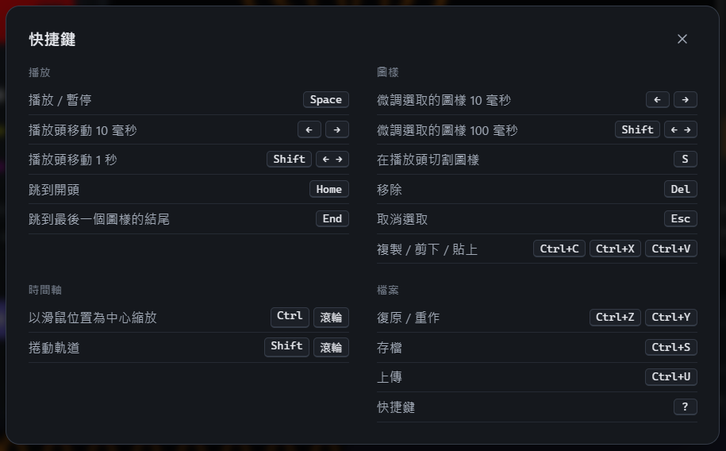

| 分類 | 快捷鍵 | 功能 |
|---|---|---|
| 播放 | `Space` | 播放 / 暫停 |
| | `←` `→` | 播放頭移動 10 毫秒 |
| | `Shift` + `←` `→` | 播放頭移動 1 秒 |
| | `Home` / `End` | 跳到開頭 / 最後一個圖樣的結尾 |
| 圖樣 | `←` `→` | 微調選取的圖樣 10 毫秒 |
| | `Shift` + `←` `→` | 微調選取的圖樣 100 毫秒 |
| | `S` | 在播放頭切割圖樣 |
| | `Del` | 移除 |
| | `Esc` | 取消選取 |
| | `Ctrl+C` / `Ctrl+X` / `Ctrl+V` | 複製 / 剪下 / 貼上 |
| 時間軸 | `Ctrl` + 滾輪 | 以滑鼠位置為中心縮放 |
| | `Shift` + 滾輪 | 捲動軌道 |
| 檔案 | `Ctrl+Z` / `Ctrl+Y` | 復原 / 重作 |
| | `Ctrl+S` | 存檔 |
| | `Ctrl+U` | 上傳 |

> macOS 請把 `Ctrl` 換成 `⌘`。

---

## 10. 常見問題

**Q：預覽的旋轉速度和實際道具不一樣？**
預覽右上角的速度滑桿只是模擬用，實際效果取決於道具揮動或旋轉的速度。可以用「重複次數」或「慢 ↔ 快」滑桿調整圖樣的密度。

**Q：開啟舊專案時出現「圖片遺失」？**
專案只記錄圖片路徑。可以在提示中選擇搜尋並取代，或用「檔案 › 取代圖片位置...」重新指定資料夾。要把專案帶到其他電腦時，建議先用「匯出圖庫...」把圖片一起帶走。

**Q：文字分頁找不到原本的字型？**
如果專案使用的字型在這台電腦上沒有安裝，軟體會自動改用其他字型並提示。安裝該字型後重新開啟專案即可。

**Q：可以開啟舊版的 .pmc / .pmc3 檔嗎？**
不行，請使用舊版 PixelMCreator 開啟。
